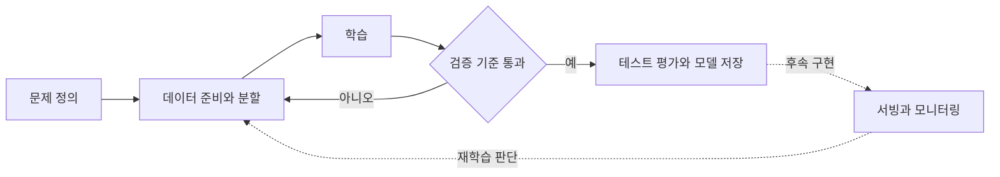

# CH1·CH2: MLOps 개념과 이번 실습

학습 출발점: [스터디 CH1 & CH2](https://app.notion.com/p/gasidaseo/CH1-CH2-3fc50aec5edf8044ac0ddd42539fe7e6).
2026-10-20 로그인 세션에서 범위와 도전과제를 확인했다.
아래는 개념을 이번 프로젝트에 적용한 자체 정리이며 강의 원문이나 책 그림의 복제가 아니다.

## 문제에서 시작하기

모델을 훈련하기 전에 사용자 문제, 입력·출력, 허용 오류, 운영 비용을 정해야 한다.
단순 규칙으로 충분한 문제라면 머신러닝을 도입할 이유부터 검토한다.
이번 예제는 8×8 손글씨 이미지의 숫자를 0~9로 분류한다. 실제 문서 OCR과는
데이터와 난이도가 다르며, 후속 OCR 프로젝트를 위한 학습·평가 흐름 연습이다.

## 수명주기와 구현의 대응

| 단계 | 이 실습에서 확인하는 것 | 후속 단계 |
|---|---|---|
| 문제 정의 | 숫자 10개 클래스, 검증 정확도 90% 기준 | 실제 문서의 오류 비용과 지연 SLO 정의 |
| 데이터 준비 | 내장 digits 데이터, 픽셀 범위, 층화 분할 | 외부 데이터 품질 검사·라벨링 |
| 버전 관리 | Git 커밋, uv.lock, 데이터·분할 SHA-256 | 데이터 저장소와 DVC 등 검토 |
| 학습 | 시드·학습 횟수·환경을 기록한 PyTorch MLP | 실험 추적 서버, 하이퍼파라미터 탐색 |
| 검증 | validation 기준 미달이면 모델 저장 차단 | 세부 클래스·편향·강건성 검증 |
| 최종 평가 | 통과한 모델만 test 세트로 한 번 평가 | 새 평가 세트와 업무 담당자 승인 |
| 배포 | 노드별 GPU 학습 Job 정의, 모델 파일 저장 | 추론 서비스와 버전별 rollout/rollback |
| 관측 | 실행별 JSON 지표와 종료 코드 | 지연·오류·데이터 드리프트·정답 기반 성능 |
| 재학습·폐기 | 수동으로 새 실행 디렉터리 생성 | 트리거, 승격 정책, 모델 보존·폐기 정책 |

모니터링에서 데이터 분포 변화가 감지되어도 성능 하락이 확정되는 것은 아니다.
정답 수집과 성능 평가를 함께 설계해야 한다. 시험 데이터를 반복 확인하며 모델을
선택하면 그 데이터도 사실상 검증 세트가 되므로 최종 성능의 독립성이 사라진다.

## DevOps와 MLOps

두 분야 모두 테스트, 버전 관리, 자동화, 관측, 안전한 릴리스를 활용한다.
ML 시스템에서는 코드가 같아도 데이터·모델이 바뀌면 결과가 바뀐다.
따라서 코드 테스트 외에 데이터 품질, 실험 조건, 모델 품질, 데이터와 모델의 관계를
추적해야 한다. 운영에서 정답이 늦게 도착하는 경우에는 성능 평가도 지연된다.

## 플랫폼 역량

Python·ML의 기초와 함께 Linux, 컨테이너, Kubernetes, 저장소, CI/CD, 관측을 연결한다.
모든 도구를 처음부터 설치하기보다 재현성·공유·운영에서 실제로 생긴 문제에 맞춰 추가한다.
책에서 소개하는 OCR, 추천, RAG는 같은 플랫폼 원칙을 다른 데이터와 평가 방식에 적용하는
후속 프로젝트 후보다. 이 저장소의 초기 구현이 세 프로젝트 전체를 구현한 것은 아니다.

## 현재 성숙도

이 실습은 수동 실행 중심인 Level 0에서 재현성과 검증 자동화를 연습하는 단계다.
CI가 있어도 지속 재학습, 데이터 검증, 모델 승격과 배포가 연결되지 않았으므로 Level 2라고
부를 수 없다. Level 1은 학습 파이프라인 자동화, Level 2는 그 파이프라인의 변경·검증·배포
자동화까지 고려한다. [Google Cloud의 MLOps 성숙도 설명](https://cloud.google.com/architecture/mlops-continuous-delivery-and-automation-pipelines-in-machine-learning).

## GPU 사용의 의미

e101과 e102는 각 1개의 GPU에서 독립 실행한다. 두 장의 메모리를 합치는 구성이나
분산 학습이 아니다. 이 데이터는 작아서 CPU가 더 빠를 수도 있다.
목적은 GPU 성능 비교가 아니라 컨테이너 자원 요청, CUDA 경로, 지표와 아티팩트 추적이다.

공식 참고:
[digits 데이터](https://scikit-learn.org/stable/modules/generated/sklearn.datasets.load_digits.html),
[PyTorch 버전별 설치](https://pytorch.org/get-started/previous-versions/),
[Kubernetes GPU 스케줄링](https://kubernetes.io/docs/tasks/manage-gpus/scheduling-gpus/).
